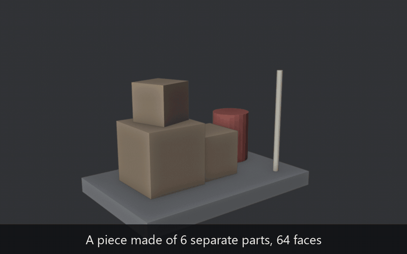
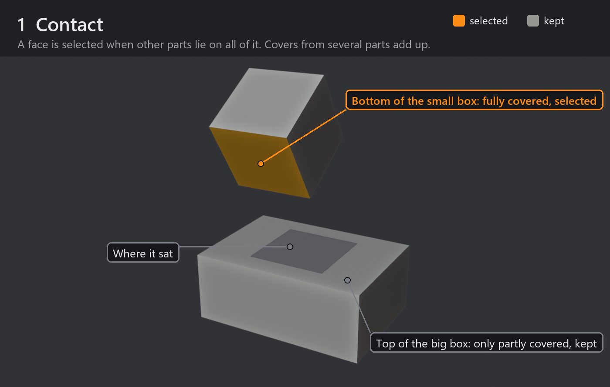
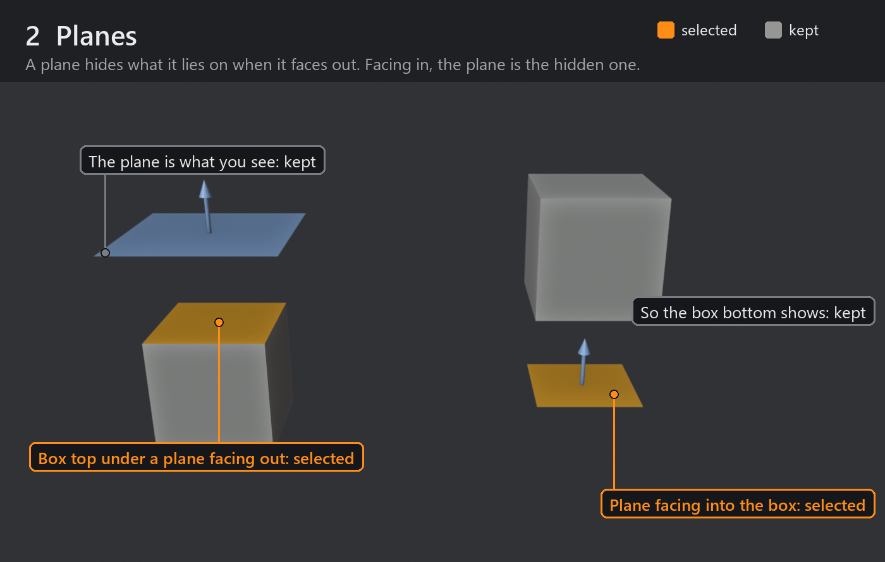
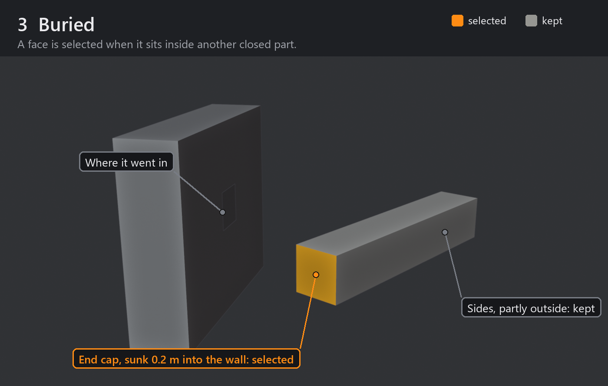
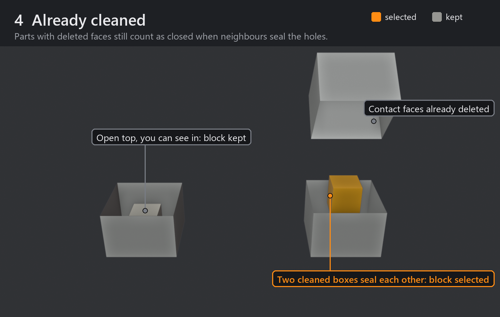

# Select Covered Faces

**A Blender extension that selects every face the player can never see, in one click.**

When a model is built from separate parts, many faces end up pressed against another part or sunk inside one. They cost polygons, texture space and bake time, and nobody ever sees them. Finding them by hand means checking every part, and some always slip through. This finds all of them for you.

It sits where Blender's own selection tools are: **Edit Mode → Select → Select All by Trait → Covered Faces**, right under *Interior Faces*. It only selects; you decide what to delete.

---

## Quick guide

**Install (once)**
1. Download [`covered_faces-1.1.2.zip`](dist/covered_faces-1.1.2.zip) (or take it from [Releases](../../releases)).
2. In Blender: **Edit → Preferences → Get Extensions → ⌄ (top right) → Install from Disk…** and pick the zip. It's on right away.

**Use**
1. In Object Mode, select all the parts of your piece (joined or not), for example with **A**. Press **Tab**.
2. **Select → Select All by Trait → Covered Faces.** The status bar says how many faces it found.
3. Check them: **Shift+H** shows only the selection, **Alt+H** brings the rest back.
4. Parts placed by eye with tiny gaps? Open **Adjust Last Operation** (bottom left) and raise **Contact Distance**, e.g. to 1 mm.
5. **X → Faces.** Ctrl+Z if you change your mind.

You can run it again at any time, also after you have cleaned parts by hand.

| Option | What it does |
|---|---|
| **Extend** | Add to the current selection instead of replacing it |
| **Contact Distance** | Gaps up to this size count as touching (default 0.1 mm, like Merge by Distance) |
| **Buried Faces** | Also select faces sunk inside other closed parts |
| **Sealed Pockets** | Also select faces that look into a thin space closed off on every side, such as the gap between a wall's two planes |
| **Pocket Depth** | How deep such a space may be (default 5 cm). Deeper closed spaces, like the inside of a closed crate or a room, are kept: someone could look in there |

---

## What it selects

Orange means selected, grey means kept. The parts are pulled apart here only so you can see the faces that touch.

The checks behind the pictures:

- **Contact** is exact. The touching faces are laid over each other in 2D with Blender's own triangulation, so no thin open strip slips through. Strips thinner than the contact distance count as closed.
- **Planes** count as one-sided, the way game engines draw them by default.
- **Buried** is exact when the open part of a face crosses no other part's surface. Where it does cross one, points on a fine grid are tested.
- **Already cleaned**: a part with holes counts as closed when every hole would itself be a covered face, sealed by a neighbour. A real opening (a bucket's top, a window) stays open. A plane never counts as a solid.
- **Sealed pockets**: a wall made of two loose planes, closed off by the trims around it, holds no volume of its own. A plate on its front sits back to back with the front plane and looks into the gap between the two planes. Such a face is selected when the space in front of it is no deeper than the pocket depth and, from points across the face, 256 lines of sight in every direction all end on the piece. This check works by sampling, so a pinhole far smaller than the face can slip past it. Points sunk inside closed parts are left to Buried Faces.

Every object in Edit Mode counts as part of the piece, and each loose part counts on its own, so joined meshes work too.

## Good to know

- Only objects in Edit Mode cover each other. Leave out what isn't part of the piece.
- Modifiers (Mirror, Array, Solidify…) are not taken into account. Apply them first.
- Linked duplicates: a face is selected only if it is covered in **every** copy, because deleting it changes all of them.
- Faces hidden with H are never selected, but they still cover others.
- A part with flipped normals, an edge shared by three or more faces, or two holes touching at one corner is never treated as a solid. It still covers through contact.
- The same care as when you clean by hand: keep covered faces on parts that move, and on kit pieces that get reused elsewhere.

## Develop

- Code: [`covered_faces/__init__.py`](covered_faces/__init__.py). Manifest: [`covered_faces/blender_manifest.toml`](covered_faces/blender_manifest.toml).
- Tests (36 cases: boxes, planes, joined, rotated, mirrored, buried, gaps, linked duplicates, cleaned parts, open buckets, chains, sealed pockets, a closed crate, a 400-box stack timed at about 1 s):
  `blender -b --factory-startup --python tests/run_tests.py`
- Pictures: `blender -b --factory-startup --python docs/visuals/render_visuals.py`, then `python docs/visuals/compose.py` (needs Pillow and ffmpeg).
- Build: `blender -b --command extension build --source-dir covered_faces --output-dir dist`

Built and tested on Blender 5.2.3; needs 4.2 or newer.

## Versions

- **1.1.2** (5 Nov 2026): new: sealed pockets. A plate on a wall made of two loose planes was missed, because the gap between the planes is closed only by the parts around it; now it is selected (option **Sealed Pockets**, depth limit **Pocket Depth**). Fix: mirrored parts (negative scale) with holes were read inside out and never counted as sealed.
- **1.1.1** (5 Nov 2026): fix: when a part's covered faces used all its corners (a board under a tabletop and between two legs), Blender's vertex select mode also selected the rest of that part. Update if you have 1.1.0 or 1.0.0.
- **1.1.0** (5 Nov 2026): parts with holes count as closed when neighbours seal them, so it works after cleaning by hand.
- **1.0.0** (5 Nov 2026): first version.

## License

[GPL-3.0-or-later](LICENSE), like Blender.

Made by [Ash & Pause](https://ashandpause.com).
