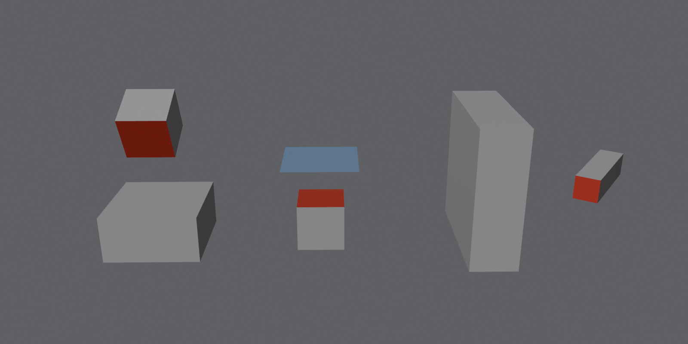

# Select Covered Faces

A Blender extension that selects every face the player can never see: faces pressed against another part, or buried inside one. Select them all in one go, check the selection, delete. No more hunting for them face by face.

It sits where Blender's own selection tools are: **Edit Mode → Select → Select All by Trait → Covered Faces**, right under *Interior Faces*.

*The demo pulled apart. Red marks the faces it selected. Left: the slim box's bottom (the thick box's top is only partly covered, so it stays). Middle: the box top under a plane (the plane stays). Right: a beam's end cap sunk inside a wall.*

---

## Quick guide

**Install (once)**
1. Download [`covered_faces-1.1.0.zip`](dist/covered_faces-1.1.0.zip) (or take it from [Releases](../../releases)).
2. In Blender: **Edit → Preferences → Get Extensions → ⌄ (top right) → Install from Disk…** and pick the zip. It's turned on right away.

**Use**
1. In Object Mode, select every object of the piece (joined or not), for example with **A**. Press **Tab**.
2. **Select → Select All by Trait → Covered Faces.** The status bar shows how many faces it selected.
3. Check what it picked: **Shift+H** shows only the selection, **Alt+H** brings the rest back.
4. Parts placed by eye with tiny gaps? Open **Adjust Last Operation** (bottom left) and raise **Contact Distance** (e.g. to 1 mm).
5. Happy with the selection? **X → Faces.** If not, Ctrl+Z.

It only selects; it never deletes anything itself. You can run it again at any time, even after you've cleaned parts by hand.

**Options** (in Adjust Last Operation)
- **Extend**: add to the current selection instead of replacing it.
- **Contact Distance** (default 0.1 mm, like Merge by Distance): gaps up to this size count as touching.
- **Buried Faces**: also select faces sunk inside other closed parts.

---

## How it decides

A face is covered when every point of it is closed off, so neither the camera nor light can reach it. Two things can close it off:

- **Contact:** faces of other parts lie on it, within the contact distance, facing the right way. Covers from any number of parts add up. This check is exact: the faces are overlaid in 2D with Blender's own constrained triangulation, so no thin open strip slips through. Strips thinner than the contact distance count as closed.
  - A solid covers a face only when the two face each other.
  - A plane or open mesh covers a solid's face when it lies on it **facing the same way**, because then the plane is what the camera sees. If the plane faces *into* the solid, game engines cull it, so the solid's face shows and the **plane** is the one selected.
- **Buried:** whatever contact leaves open lies inside other closed parts. If that region crosses no part's surface, this check is exact. Otherwise points are sampled on a grid.

Every object in Edit Mode counts as part of the piece, and each loose part counts on its own, so joined meshes work too.

**Parts with holes (already cleaned by hand).** A part with holes counts as closed if every hole would itself pass as a covered face. The tool puts a temporary patch over each hole and tests it the same way: a neighbour lies on it, or it sits inside a neighbour.
- A hole left by cleaning is sealed, so the part still counts as a solid and can hold buried faces.
- A real opening (a bucket's top, a window) stays open, so faces you can see through it are kept.
- Two cleaned parts can seal each other: two boxes that both lost their contact faces, or two buckets rim to rim. Chains of cleaned parts work too.
- A plane is never treated as a solid: a part has to enclose real volume, thicker than the contact distance.

## Limits

- Only objects in Edit Mode cover each other. Leave out what isn't part of the piece.
- The test uses the base mesh: modifiers (Mirror, Array, Solidify…) are not taken into account. Apply them first.
- A part with flipped normals, an edge shared by three or more faces, or two holes touching at one vertex is never treated as a solid. It still covers through contact.
- Linked duplicates: a face is selected only if it is covered in **every** copy of the mesh in the view layer, because deleting it changes every copy.
- Faces hidden with H are never selected, but they still cover other faces.
- Double-sided materials aren't handled: a plane counts as one-sided.
- The same care as when you clean by hand: keep covered faces on movable or physics objects, and on kit pieces that get reused elsewhere.

## Develop

- Code: [`covered_faces/__init__.py`](covered_faces/__init__.py). Manifest: [`covered_faces/blender_manifest.toml`](covered_faces/blender_manifest.toml).
- Tests (28 cases: boxes, planes, joined, rotated, buried, gaps, linked duplicates, cleaned parts, open buckets, chains, a 400-box stack timed at about 1 s):
  `blender -b --factory-startup --python tests/run_tests.py`
- Demo picture: `blender -b --factory-startup --python tests/render_demo.py`
- Build: `blender -b --command extension build --source-dir covered_faces --output-dir dist`

Built and tested on Blender 5.2.3; needs 4.2 or newer. If a future Blender changes the Select All by Trait menu, the entry goes at the end of that menu instead.

## Versions

- **1.1.0** (5 Nov 2026): parts with holes count as closed when neighbours seal them, so it works after cleaning by hand.
- **1.0.0** (5 Nov 2026): first version.

## License

[GPL-3.0-or-later](LICENSE), like Blender.

Made by [Ash & Pause](https://ashandpause.com).
